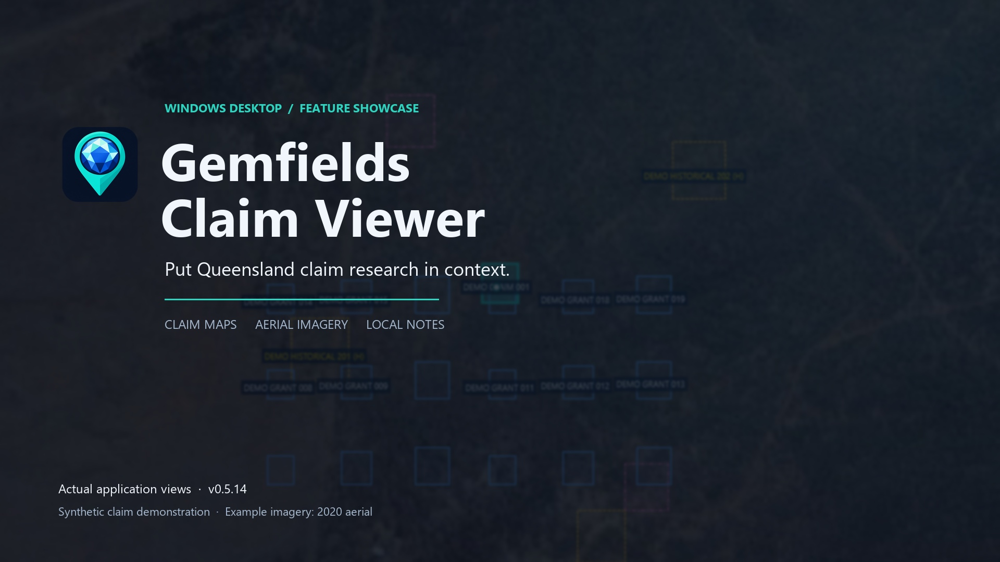

# Gemfields Claim Viewer

Gemfields Claim Viewer is an independent Windows desktop research application for looking up Queensland mining claims and mining leases, seeing them in map context, and keeping local research notes.



## Download

Download the current Windows installer from this repository’s **Releases** section. Do not use GitHub’s automatically generated “Source code” archives; they are not the Windows application.

Current release asset:

`GemfieldsClaimViewer-Setup-v0.5.14-win-x64.exe`

The installer is self-contained and includes the .NET desktop runtime. It installs for the current Windows account and does not require administrator rights. The release is currently unsigned, so Windows may show an unknown-publisher or reputation warning.

## Verify the installer

SHA-256 for v0.5.14:

`E2443D2E59D0EE35B3E3BAF7C16C621CC4633AF395DD150CCB0BEFA1A8B5E756`

PowerShell verification:

```powershell
Get-FileHash .\GemfieldsClaimViewer-Setup-v0.5.14-win-x64.exe -Algorithm SHA256
```

The returned hash must exactly match the value above.

## What it does

- Looks up MC and ML authorities through configured Queensland Government spatial services.
- Opens neutrally with a grey `MC or ML 00000` example and waits for the user to choose an authority; the example is not searched.
- Distinguishes current grants, applications and historical footprints.
- Shows native interactive claim maps, road context and optional public imagery.
- Provides optional fossicking, protected-area and indicative native-title/parcel context layers.
- Keeps saved-claim bookmarks and notes locally on the user’s computer.
- Includes a dated, bounded Gemfields claims-library snapshot for local research where coverage permits.

See [Installation](docs/INSTALLATION.md), [Privacy](PRIVACY.md), and the detailed [Data-source register](docs/DATA_SOURCES.md).

## Important limitations

This is an independent research tool, not a Queensland Government application. It does not establish legal tenure status, land availability, survey boundaries or access rights. Verify relevant information through current official channels before relying on it.

The public repository is a binary-release and documentation repository. The development source remains private.

## Release verification

The v0.5.14 candidate completed the project’s existing release test suite with 51/51 tests passing on 10 November 2026. The installer smoke workflow installed a uniquely identified test copy, confirmed registration, shortcuts, application launch with the bundled runtime, uninstall and saved-data preservation.

## Licence

The compiled application is available without charge for lawful research use under the [Gemfields Claim Viewer end-user licence](LICENSE.md). The development source remains private, and the licence does not permit redistribution, resale or repackaging.

