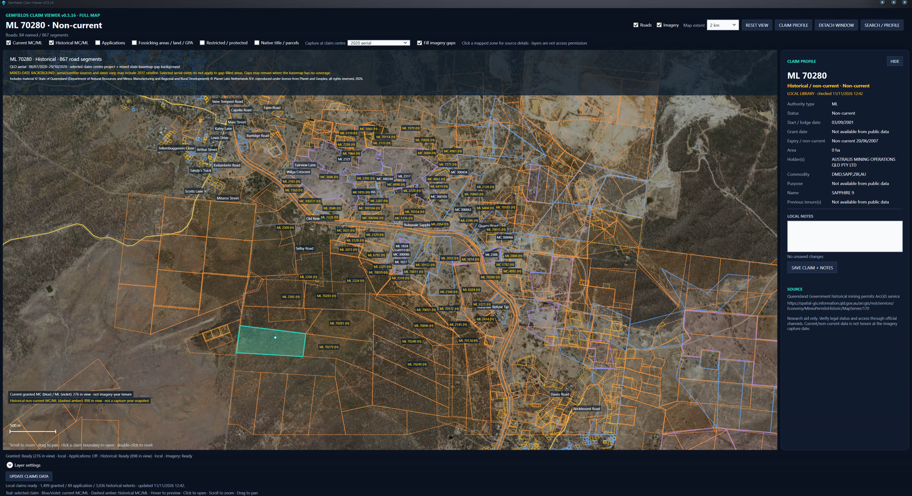
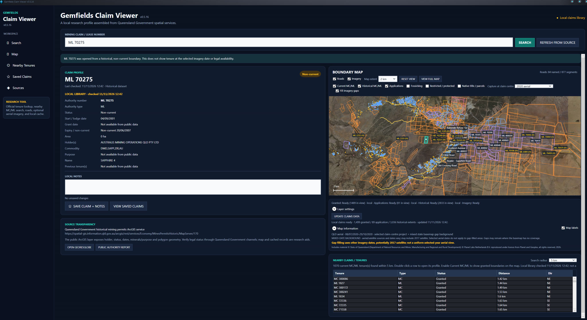

# Gemfields Claim Viewer

Gemfields Claim Viewer is an independent Windows desktop research application for looking up Queensland mining claims and mining leases, seeing them in map context, and keeping local research notes.

[Visit the Gemfields Claim Viewer website](https://gemfieldsviewer.app/)

## Download

**[Download Gemfields Claim Viewer v0.5.18 for 64-bit Windows](https://github.com/joshg524/Gemfields-Claim-Viewer-Releases/releases/download/v0.5.18/GemfieldsClaimViewer-Setup-v0.5.18-win-x64.exe)**

See the [v0.5.18 release notes and assets](https://github.com/joshg524/Gemfields-Claim-Viewer-Releases/releases/tag/v0.5.18) or [download the SHA-256 checksum](https://github.com/joshg524/Gemfields-Claim-Viewer-Releases/releases/download/v0.5.18/GemfieldsClaimViewer-Setup-v0.5.18-win-x64.exe.sha256).

The installer is self-contained and includes the .NET desktop runtime. It installs for the current Windows account and does not require administrator rights. The release is currently unsigned, so Windows may show an unknown-publisher or reputation warning.

## Verify the installer

Compare the downloaded installer’s SHA-256 with the value below.

`17A3000386D38E3ED21CB45E0F06B62C20DC481CBD39773A00A115FD001F161A`

```powershell
Get-FileHash .\GemfieldsClaimViewer-Setup-v0.5.18-win-x64.exe -Algorithm SHA256
```

## Application views from v0.5.16

### Full map



### Claim profile and boundary map



## What it does

- Looks up MC and ML authorities through configured Queensland Government spatial services.
- Opens maximized with current MC/ML boundaries ready to browse and public imagery when available. Enter an authority number in the search field to look up a specific claim.
- Distinguishes current grants, applications and historical footprints.
- Shows interactive claim maps, road context and optional public imagery. **CLEAR ALL** hides the optional map layers.
- Provides optional fossicking, protected-area and indicative native-title/parcel context layers.
- Keeps saved-claim bookmarks and notes locally on the user’s computer.
- Includes a dated, bounded Gemfields claims-library snapshot for local research where coverage permits.

See [Installation](docs/INSTALLATION.md), [Privacy](PRIVACY.md), and the detailed [Data-source register](docs/DATA_SOURCES.md).

## Important limitations

This is an independent research tool, not a Queensland Government application. It does not establish legal tenure status, land availability, survey boundaries or access rights. Verify relevant information through current official channels before relying on it.

The public repository is a binary-release and documentation repository. The development source remains private.

## Release verification

The v0.5.18 build passed 55/55 automated tests, including checks for compact-map label rendering and imagery retention during a simulated service failure. The installer version and SHA-256 were verified before publication.

## Licence

The compiled application is available without charge for lawful research use under the [Gemfields Claim Viewer end-user licence](LICENSE.md). The development source remains private, and the licence does not permit redistribution, resale or repackaging.

